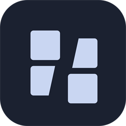
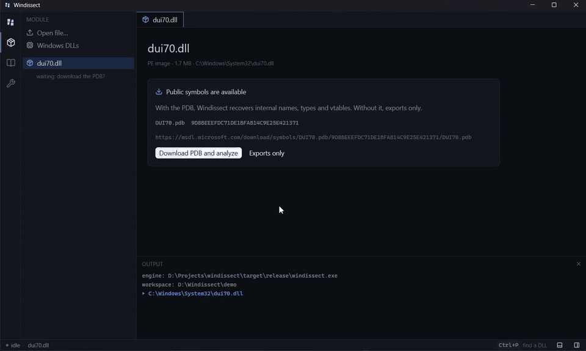

<div align="center">



# Windissect

**Proven maps of Windows internals, from a binary and its PDB.**

[](LICENSE)
[](https://github.com/razecrs/windissect/releases/latest)


[](https://discord.gg/wveT8zFCus)

[Download](https://github.com/razecrs/windissect/releases/latest) · [Desktop app](#desktop-app) · [Quick start](#quick-start) · [ReWindows corpus](#rewindows) · [Docs](#documentation) · [Discord](https://discord.gg/wveT8zFCus)

<br>



<sub>A first run on <code>dui70.dll</code>, from a cold cache. The analysis is shown at 4× speed and browsing at 2.5×.</sub>

</div>

Windissect turns a Windows PE binary (DLL, EXE or SYS) and its matching
Microsoft PDB into a build-anchored, machine-readable map of that binary's
internals, then generates C, C++ and Rust you can build against.

It only emits what it can prove. Every fact carries its evidence, and anything
that isn't proven stays marked as a candidate instead of showing up as a
callable declaration. When Windows updates, Windissect records the new build
and diffs it against the last one.

## ReWindows

Windissect's output for Windows system DLLs is published in the
[ReWindows](https://github.com/ReWindows) organization, one repository per DLL
(`dwmcore`, `uDWM`, `dcomp`, `twinui`, `twinui.pcshell`, `comctl32`,
`uxtheme`, `taskbar` and 130+ more). Each repository has a `history/` archive
of every build observed, plus C/C++ headers and Rust FFI crates where the
evidence supports them. If you only need the data, start there.

## What it produces

- JSON IR for exports and private PDB procedures, tied to the exact build
  (image SHA-256, timestamp, PDB GUID and age)
- MSVC-demangled signatures parsed into structured C++ types
- function sizes, implementation hashes, call edges and imported APIs
- class layouts, inheritance, vtable slot order and enum values, verified
  against the binary and round-tripped through a compiler
- C/C++ headers and Rust FFI crates, split into verified and candidate output
- typed call helpers for x64, emitted only when both the address and the
  signature are proven
- C symbol tables with RVAs
- per-build history and semantic diffs between Windows builds

Generated headers compile as C17, C23, C26 draft, C++17, C++20, C++23 and
C++26 draft.

## How it compares

On `dui70.dll` (DirectUI), against the hand-maintained DirectUI headers in
ExplorerPatcher:

| | Windissect | ExplorerPatcher |
|---|---:|---:|
| Classes | 766 | 350 |
| Declarations | 7,532 | 4,095 |
| Generated headers | 396 | 159 |
| Verified vtables | 440 | n/a |
| Verified vtable slots | 8,370 | n/a |
| Rust bindings | yes | no |

Extracting the DLL and PDB takes about 2 seconds, and semantic refinement about
14 seconds.

## Desktop app

Version 1.0 ships a desktop workbench, `Windissect-GUI.exe`. It opens a
binary, downloads the exact PDB when needed, and lets you browse types,
vtables, functions and evidence without touching the command line. No
installation or administrator rights are needed. Output goes to
`%LOCALAPPDATA%\Windissect\workspace` by default.

It can also show what you're inspecting on your Discord profile, the way
editor extensions do. That goes through the Discord desktop app's local pipe,
needs no login or token, and can be switched off under Tools. See
[gui/DISCORD.md](gui/DISCORD.md).

The Windows package also includes `windissect.exe` (the CLI) and
`windissect-fleet.exe` (batch runs). Build it with
`pwsh -File scripts/package-windows.ps1`.

## Quick start

On Windows with Rust installed:

```powershell
pwsh -File scripts/demo.ps1
```

This analyzes your installed `amsi.dll`, verifies the IR, and writes C, C++,
Rust, symbol and evidence output to `target/demo/amsi/`. See
[docs/quickstart.md](docs/quickstart.md) for the full DirectUI run.

## Interactive terminal UI

An Ink-based terminal workbench provides guided forms, exact command previews,
live output, cancellation, and status reporting for the most common workflows:

```powershell
cd tui
npm install
npm run dev
```

It drives the same Windissect executable and does not reinterpret results or
mix verified facts with candidates. See [tui/README.md](tui/README.md).

Launching `windissect` without a subcommand opens the TUI. For a complete
non-interactive workspace in one command:

```powershell
windissect analyze challenge.exe --out windissect-work\challenge
```

Interactive launch stays in the current terminal without elevation. Use
`windissect --elevate` only when administrator access is actually required;
Windows UAC necessarily opens a new elevated process. Relative output paths are
resolved against the directory where Windissect was launched, and every
generated-file message prints the full absolute path. If Windows refuses to
open a target, Windissect queries Restart Manager and reports the locking
application and PID when available.

This writes IR, a string inventory, annotated assembly, C/C++ headers, Rust
bindings, strict evidence surfaces, documentation, and runs IR verification.
When IDA/Hex-Rays is installed, it also writes `pseudocode.c` plus a provenance
JSON file. Pseudocode is always labeled candidate output: it is reconstructed
logic, not verified original source.

The decompiler stage can also be run alone:

```powershell
windissect decompile challenge.exe --out pseudocode.c
windissect decompile challenge.exe --rva 0x2550 --out sub_2550.c
windissect decompile challenge.exe --scope all --out every_function.c
```

The default `target` scope starts from `main`, `WinMain`, or the image entry
point, follows direct calls, and stops at recognized compiler/CRT/library
boundaries. Use `--scope all` when those implementation bodies are wanted.

Inside the TUI, **Browse functions** opens a split explorer: the function
inventory stays on the left while evidence, confidence, calls, imports and an
assembly preview update on the right. Open a function and press `d` to
decompile only that RVA and read the candidate C inline. Compiler/runtime
helpers are hidden by default and can be toggled with `h`.

The TUI runs in the PowerShell that launched it and does not request elevation.
`--elevate` is an explicit opt-in and Windows will show a UAC prompt. Elevation
does not bypass an exclusive file-sharing lock; Windissect instead reports the
locking application and PID so it can be closed deliberately.

## Analyze one binary

```powershell
cargo build --release
$wd = "target\release\windissect"

& $wd extract C:\Windows\System32\dwmapi.dll --pdb dwmapi.pdb --out ir\dwmapi.json
& $wd verify --ir ir\dwmapi.json
& $wd emit-headers --ir ir\dwmapi.json --out headers\dwmapi
& $wd emit-rust --ir ir\dwmapi.json --out rust\dwmapi-sys
& $wd emit-syms --ir ir\dwmapi.json --out syms
& $wd refine --semantic --ir ir\dwmapi.json --binary C:\Windows\System32\dwmapi.dll `
    --out refinement\dwmapi.json --out-ir ir\dwmapi.semantic.json --semantic-out semantic\dwmapi
```

The PDB is optional. Without one you get exports only, and private types are
reported as unavailable rather than guessed.

For quick binary exploration, string search does not require a PDB or IR:

```powershell
& $wd strings challenge.exe "flag{" --encoding all --min-length 4
& $wd strings challenge.exe --json --limit 0
```

Results include the file offset, encoding, and an RVA whenever the offset maps
into a PE image section.

For Electron desktop applications (`.asar` archives, loader `index.js`, host
binaries, or unpacked app directories):

```powershell
& $wd electron path\to\app --out ir\electron.json
& $wd verify --ir ir\electron.json
```

This records the Electron and Chromium runtime versions, archive header/SHA-256
integrity metadata, every loader's exact verbatim shape, the Electron APIs
relied on, `contextBridge` globals, and IPC channels.

`emit-headers` writes `<target>.h` with verified ABI metadata and proven call
helpers only. Everything else Windissect reconstructed goes into
`<target>_candidates.h`, which is opt-in and not ABI-safe.

`refine --semantic` also writes a recovery plan (`recovery-plan.json` and
`recovery-plan.md`) listing each unresolved fact and the evidence that would
settle it.

## Track Windows builds

```powershell
& $wd record-build ir\dwmapi.json --history history
& $wd diff ir\old\dwmapi.json ir\new\dwmapi.json --json-out changes.json --markdown-out changes.md
```

The history layout is plain files, so it can be served from any static host:

```text
history/index.json
history/<target>/index.json
history/<target>/builds/<timestamp-guid-age>/ir.json
history/<target>/changes/<old>__<new>.json
history/<target>/changes/<old>__<new>.md
```

Diffs separate added and removed symbols from signature, implementation,
call-graph, import, size and export changes. RVA moves are tracked on their
own, so address churn doesn't look like a behavior change.

## Run the whole fleet

`windissect-fleet` processes a list of binaries in one go: it finds each one
on your machine, downloads the exact PDB from Microsoft's symbol server,
extracts, verifies, records history and generates headers and Rust crates.
Runs are incremental, so after a Windows update the same command picks up only
what changed.

```powershell
cargo build --release
go build -o bin\windissect-fleet.exe .\cmd\windissect

# small test run
bin\windissect-fleet.exe --root corpus --manifest manifests\example.json

# the built-in Windows UI list (33 targets, large PDB downloads the first time)
bin\windissect-fleet.exe --root corpus
```

What it processes is controlled by a JSON manifest. See
[docs/fleet.md](docs/fleet.md) for the manifest format, commands, output layout
and troubleshooting, or run `bin\windissect-fleet.exe help`.

This repository doesn't include any Microsoft binaries or PDBs.

## Documentation

- [Architecture](docs/architecture.md): pipeline, trust rules, module map
- [Output status](docs/output-status.md): what counts as verified and what doesn't
- [Quick start](docs/quickstart.md): AMSI and DUI70 walkthroughs
- [Fleet runs](docs/fleet.md): manifests, batch runs, output layout
- [Known issues](docs/known-issues.md)
- [Release notes](RELEASE.md)

## Meet Elytra

<p align="center">
  
  
  
  
  
  
</p>

Elytra is Windissect's mascot, a small beetle named after the hard wing cases
that close over its back. The seam where they meet runs at the same angle as
the blade in the logo. The artwork and its source are in
[gui/assets/brand/mascot](gui/assets/brand/mascot).

## License

Windissect is licensed under the [GNU Affero General Public License v3.0](LICENSE).

For a commercial license (using Windissect in closed-source products or
services without the AGPL terms), contact raze.crs@proton.me.
