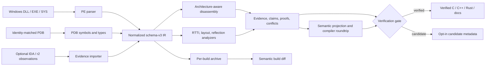

# Architecture

Windissect separates evidence collection from claims and callable output. A
name or instruction observation does not become a usable declaration unless
the relevant proof obligations pass.

The central invariant is that uncertainty remains visible. Unsupported
architectures, mismatched PDBs, signature conflicts, and heuristic layout
observations are rejected or emitted as metadata rather than being presented
as callable interfaces.

## Pipeline boundaries

- `extract` establishes binary identity, reads PE/PDB records, and runs static
  analyzers.
- Schema-v3 IR retains observations, claims, proof obligations, conflicts,
  capability outcomes, and a typed semantic projection independently.
- `verify` checks graph integrity and generic invariants; optional profiles add
  target-specific ground-truth checks.
- Emitters consume the IR and separate verified surfaces from experimental or
  metadata-only results.
- `refine --semantic` validates the exact input hash, projects class/union
  layouts, inheritance, vtable order, and enums, then compiles generated C++
  and Rust before writing the refined IR. It also emits a target-independent
  recovery plan that classifies every remaining semantic and ABI gap by the
  static, PDB, RTTI, call-site, or runtime evidence needed to resolve it.
- `score-semantic` compares verified facts with an exact-build owned oracle and
  fails below the requested precision threshold.
- `record-build` stores immutable snapshots and produces adjacent semantic
  JSON and Markdown diffs.
